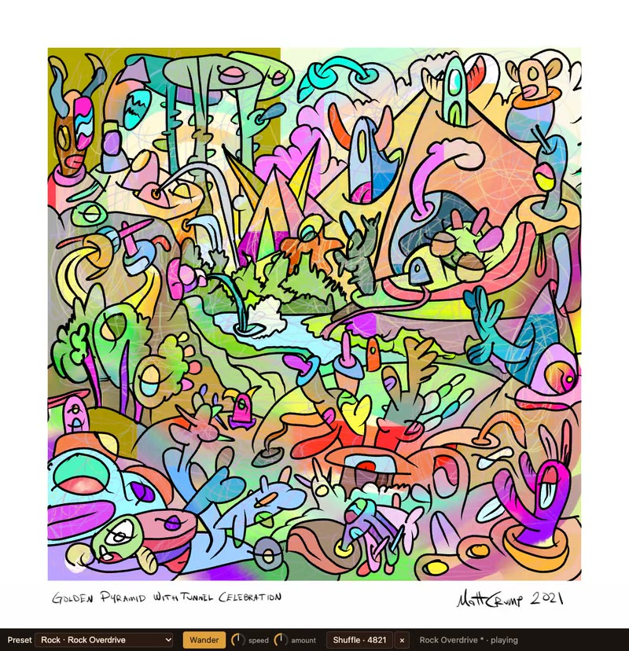

# thingsynth

One painting by Matt Crump, *Golden Pyramid With Tunnel Celebration* (Colorlands, 2022), as the interface to
[SynthLand](https://github.com/CrumpLabSandbox/SynthLandExplorer)'s **Tonewheel** organ. The painting fills the
browser window; regions of it, described in `mapping.json`, control Tonewheel parameters; the computer keyboard
and Web MIDI play notes. Everything runs in the browser (WebAssembly in an AudioWorklet).

See [PLAN.md](PLAN.md) for the architecture, the mapping schema and the parameter list.

[](docs/demo/thingsynth-demo.mp4)

*A 28-second demo with sound (`docs/demo/thingsynth-demo.mp4`): a jazz progression, Drive heating the pyramid,
drawbars filling the stalks, wander, a preset change travelling across the painting, and a shuffle.*

## Run

Needs Node 22 and pnpm (`corepack enable` gives you the pinned pnpm).

```bash
pnpm install
pnpm dev
```

Open the printed URL (http://localhost:5173). Click or press a key to start audio.

- Notes: A W S E D F T G Y H U J K O L P ; on the computer keyboard, Z / X shift the octave. Any Web MIDI input
  plays too (Chrome, Edge; Safari needs Web MIDI enabled).
- Preset: the select in the bottom bar, or `?preset=<slug>` (slugs are the file names in
  `web/public/tonewheel/presets/`).
- `?debug` draws the mapped regions, shows pointer coordinates in image pixels and the mapped parameter values,
  logs image coordinates on every click, and has a small polygon editor (shift+click points, Enter prints a
  `mapping.json` entry). In debug, the backquote key (or `?debug=parts`) switches to parts mode: the pointer
  picks the painting's own fill shapes, outlines the one under it and shows its id, colour, area and box.
- **Wander** (the button in the bottom bar, or `?wander`): every Tonewheel parameter of the current preset takes
  its own random walk around it, so the whole painting keeps moving while you play. The *speed* dial goes from a
  slow drift to a flutter, the *amount* dial sets how far things stray (both remembered in this browser; also
  `?wander-speed=` and `?wander-amount=`, 0 to 1). Drag a dial up and down, scroll it, or use the arrow keys;
  double-click resets it. Choosing a preset re-centres the walks; setting a parameter yourself re-centres that
  one; stopping returns to the preset.
- **Shuffle** deals the parameters onto other objects of the painting from a random seed, written into the address
  (`?seed=4821`) so it can be shared; shift-click also re-deals the notes (`&notes=shuffle`); × goes back to the
  curated mapping. The pyramid keeps Drive (it is locked).
- **Bind editor** (`?debug`, then **Bind…**): click shapes of the painting, make them an object, bind a parameter or
  a note with a gesture and effects, preview it, and save it into `objects.json` and `mapping.json` (dev server
  only). See PLAN.md section 6. The current mapping is listed in `docs/mapping-proposal.md`.
- `?flat` shows the published JPEG instead of the painting rebuilt from its layers. `?mute=1` keeps the engine
  running silently (for automated checks).

Other scripts: `pnpm build` (typecheck + production build into `dist/`), `pnpm preview`, `pnpm typecheck`,
`pnpm presets` (rebuild the preset index), `pnpm sync` (re-copy from SynthLand, see [UPSTREAM.md](UPSTREAM.md)),
`pnpm demo [url]` (record the demo video: needs the dev server running, ffmpeg and Google Chrome; it drives a
headless Chrome with a throwaway profile and writes `docs/demo/`).

On phones (small touch screens) the page uses half-size raster layers and a lite mode (redrawn at most 20 times
a second, fewer idling shapes); `?lite` and `?lite=0` force it on or off.

## Layout

```
art/<slug>/             the published JPEG, meta.json, and objects.json (named groups of fill shapes)
  layers/               the painting taken apart from the PSD (tools/extract_psd.py): wash.webp, fills.svg,
                        scribbles.webp, ink.svg, caption.webp, layers.json, parts.json, check.jpg
mapping.json            objects and regions of the painting -> Tonewheel parameters (the thing Matt edits)
web/                    Vite app, plain TypeScript, no framework
  src/main.ts           boots the runtime, presets, start overlay
  src/art.ts            rebuilds the painting from art/<slug>/layers as one static SVG (or the JPEG with ?flat)
  src/painting.ts       the art + an SVG hit layer in image-pixel coordinates, gesture handling
  src/mapping.ts        mapping.json schema (v1 regions, v2 bindings), validation, value curves
  src/objects.ts        art/<slug>/objects.json resolved against the parts table
  src/effects.ts        the nine effects, note envelopes, the preset wave and idle, on the painting's own paths
  src/color.ts          OKLCH colour math with darken-first gamut mapping
  src/wander.ts         preset wander: a random walk per parameter around the preset
  src/dial.ts           the small rotary dial used for wander speed and amount
  src/shuffle.ts        seeded, shape-aware re-dealing of parameters (and notes) onto objects
  src/editor.ts         the bind editor (debug only; saves through the dev server, web/vite.config.ts)
  src/output.ts         the path to the speakers: linear to -4.4 dBFS, a soft knee that never passes -1 dBFS
  src/debug.ts          ?debug overlay, HUD and region editor
  runtime/              copy of SynthLand's web runtime (do not edit here)
  public/wasm/          additive.wasm (Tonewheel's engine)
  public/tonewheel/     plugin.json and presets
upstream/               reference copies of the Tonewheel manifest and engine params.json
scripts/                sync_upstream.sh, build_preset_index.mjs, build_worklet.mjs, record_demo.mjs
tools/extract_psd.py    PSD -> art/<slug>/layers (run with uv, authoring time only; see below)
tools/propose_objects.py  which shapes are details of which (a starting point for naming objects; uv)
tools/mapping_report.py   mapping.json + objects.json -> docs/mapping-proposal.md
```

## Re-extracting the painting from the PSD

The PSD stays outside the repo (it is the source, 217 MB). With [uv](https://docs.astral.sh/uv/) installed:

```bash
uv run tools/extract_psd.py "/path/to/Golden pyramid with tunnel celebration.psd" art/golden-pyramid-with-tunnel-celebration --reference art/golden-pyramid-with-tunnel-celebration/golden-pyramid-with-tunnel-celebration.jpg
```

It rewrites `art/<slug>/layers/` and prints how closely the rebuilt stack matches the published JPEG
(`check.jpg` shows them side by side). Fill and ink ids follow the PSD's paint order, so they only change if
the PSD's drawing changes.

## Licence

Code: GPLv3 (see [LICENSE](LICENSE)), the same licence as SynthLand, whose runtime and engine this repo copies.
The artwork in `art/` is copyright Matt Crump, all rights reserved; it is included here for this project only
and is not covered by the GPL.
