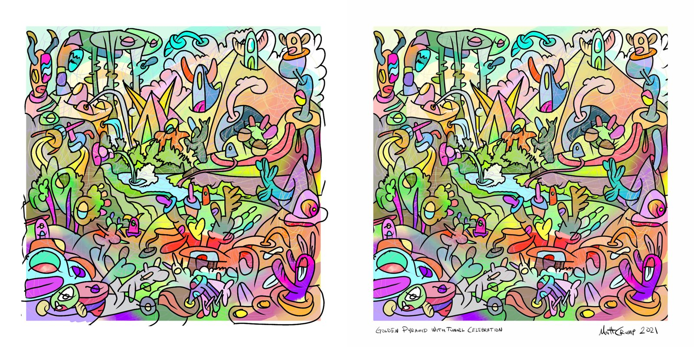

# Animation layer: plan for review

*Written 2026-10-24, revised the same day after reading the PSD. Not implemented. Review, then PLAN.md gets
the approved version.*

## 0. In one paragraph

The PSD is the painting in layers, and the drawing layers are **vector**: 312 closed, flat-coloured fill
shapes and 1,630 ink strokes as SVG paths, plus two pixel layers (a soft colour wash underneath, pencil
scribbles on top of the fills). So there is no need to cut the JPEG apart: every filled shape is already an
object part with an exact outline and colour, and every ink stroke is a path we can move. The web page
rebuilds the painting from those four layers (wash, fills, scribbles, ink) as an SVG with raster images in it,
and the composite reproduces the JPEG (picture below). Then every fill shape and ink stroke is an element
that can be animated with ordinary SVG and CSS, wired to Tonewheel in both directions: the 47 parameters each
own an object whose look tracks the parameter continuously, the 88 piano notes each own a fill shape that
lights and boils while the note sounds, and the same objects stay touchable so a drag on one still sets its
parameter. Seeded shuffle re-deals the pairing. The ink stays on top, so the piece keeps looking like the
piece.



## 0.1 What is in the PSD

`Golden pyramid with tunnel celebration.psd`, 4950 × 4950 px (twice the JPEG), Adobe Fresco / Sketch export.
Bottom to top:

| layer | kind | what it is | use |
| --- | --- | --- | --- |
| Background | solid fill | white | the page background |
| Pixel layer (8) | smart object, PSB 4200² | the soft colour wash (broad airbrush strokes) | a raster `<image>` at the bottom |
| Vector layer (9) | smart object, SVG, 1024 paths | 239 coloured fills + 785 black ink shapes | fills: the animatable objects; ink: part of the line layer |
| Pixel layer (6) | pixel 4200² | the pencil scribble underlayer, mostly transparent | a raster `<image>` between fills and ink; can also be animated as a whole |
| Vector layer (7) | smart object, SVG, 918 paths | 73 coloured fills (top-left) + 845 black ink shapes | same |
| Rectangle 1 | shape | the white border frame | static |
| sig, Layer 1 | pixel | signature and the hand-lettered title | static (or the title could be a note part, see open questions) |

Ink strokes are stored as filled outline shapes (black fill, no stroke), with brush classes like `pen`,
`line-copic`, `pencilHB`, so each stroke is one closed path with its real width baked in. Fills are closed
paths with exact colours, 39 + 169 distinct; some carry a fill-opacity below 1 (the wash shows through). No
path geometry is shared between the two vector layers, so their union is the full drawing. Both layers sit at
known offsets in the canvas (bbox 298,302 and 310,302), so canvas coordinates are SVG coordinates plus the
offset. `docs/psd-inspect-experiment.py` lists the layers; `docs/psd-vector-fills.jpg` and
`docs/psd-vector-ink.jpg` are the two vector layers rendered on their own.

Of the 312 fill shapes, 298 are bigger than 50 × 50 px and 244 bigger than 100 × 100 px at PSD scale. We need
135 elements, so the counts are comfortable even after skipping sky and ground shapes.

## 1. Identifying visual objects

**Parts (automatic, exact).** `tools/extract_psd.py` (Python with psd-tools, Pillow and resvg, run with
`uv run`; authoring time only) reads the PSD and writes into `art/<slug>/layers/`:
- `wash.png` and `scribbles.png`, the two pixel layers at 2475² (half the PSD, matching the JPEG) as PNG, plus
  an `@2x` set for later if wanted;
- `fills.svg`: the 312 coloured paths from both vector layers, each with an id (`f001`..), its colour,
  opacity, bounding box, centroid and area, coordinates rounded to one decimal and translated into the canvas
  space, in paint order;
- `ink.svg`: the 1,630 black shapes, each with an id and its bounding box, in paint order;
- `parts.json`: the table of fills and ink strokes with their numbers, and for each fill the ink strokes that
  overlap its outline (so a creature's lines can boil with its body);
- `frame.svg`: border, signature, title.
The PSD itself stays outside the repo (it is Matt's source and 217 MB); the exports are committed.

**Objects (semi-automatic, then by hand).** An object is a named group of fill parts with a role for each
(body, eye, mouth, horn, stripe, highlight). The tool proposes groups: a fill whose bounding box lies inside
another's and that touches it is a part of it; fills that share a long boundary and were painted consecutively
(paint order is a strong hint, Matt drew one creature at a time) are candidates for one object. I then check
each proposed group on a crop by eye and name it ("left-horned-creature", "golden-pyramid", "tunnel-mouth",
"stream", "ring-in-sky", "stalk-tree-3"). The result is `objects.json`. Expect 60 to 90 objects. Matt reviews
in the editor and regroups anything wrong.

**Elements to bind.** 47 objects for parameters, chosen big and distinct (the pyramid, the tunnel, the stream,
the ring, the tower, the big creatures); 88 fill parts for notes, chosen small and flat (eyes, blobs, leaves,
the crowd), none of them part of a parameter object so the two never fight. Everything else is scenery that
can still idle (section 3).

## 2. Rendering the animated painting

The page becomes one `<svg viewBox="0 0 4950 4950">` that rebuilds the PSD stack:

```
<image href="layers/wash.png">            soft colour wash, raster
<g id="fills"> 312 <path> </g>            every fill an element with its own id, colour, opacity
<image href="layers/scribbles.png">       pencil scribbles, raster, mostly transparent
<g id="ink"> 1630 <path> </g>             the line drawing, on top
<g id="frame"> border, title, signature </g>
```

The composite is the painting (the picture in section 0 was rendered exactly this way). Animation is then
ordinary SVG: a fill's `fill`, `opacity`, `transform` (about its own centroid) and `filter` change per frame
from JavaScript, or through CSS transitions for the glides. Ink strokes get `transform` for the boil. The
whole thing is a few thousand DOM nodes, which browsers handle at 60 fps as long as we only touch the
elements that are changing (bound elements, 135 plus their ink) and leave the rest static. No WebGL, no label
map, no JPEG segmentation. The scribble layer, being one image, can drift or breathe as a whole.

The hit layer for input is the same SVG: an object's fills take pointer events directly, so `mapping.json`
no longer needs hand-drawn rectangles; a binding names an object and the gesture.

Size: fills.svg about 1.5 MB after rounding, ink.svg about 3.5 MB, the two PNGs about 2 MB each at 2475²;
gzip brings the SVGs down by two thirds. If ink.svg is too heavy for phones, the fallback is the ink as one
PNG (no per-stroke boil there).

## 3. The motion vocabulary (what "change visual state" means)

Every effect is a function of a value v in 0..1 (continuous parameters) or an envelope (notes: attack on
note-on, decay after note-off), applied to the object's own fill paths and ink strokes. Rules that keep
it in the style of the piece: no new shapes; colours only move within the painting's own candy palette;
motion is small and either glides (parameters) or steps at 8 to 12 fps like hand-drawn animation (notes,
boil); ink on top, always.

| effect | what it does | good for |
| --- | --- | --- |
| `glow` | lightness up, slight saturation up, within the part | note parts (velocity → amount), bools |
| `hue` | rotate the part's hue by up to ±60° (the piece is rainbow, so a shifted part still belongs) | continuous params: drive, leakage, mic distance |
| `fill` | the shape fills from bottom to top with its brightened colour (a clip on a lighter copy of the path), like a drawbar pulled out | the 20 drawbars (0..8 → 0..1) |
| `pulse` | scale the part about its centroid by ±3 %, breathing at a rate | expression, pedal sustain, Leslie speed (stop / slow / fast = still / slow breath / fast breath) |
| `wobble` | small sinusoidal displacement of the part, like heat shimmer | vibrato / chorus mode and depth |
| `boil` | the object's ink strokes jitter by 1 to 2 px each, re-rolled at 8 fps (the classic hand-drawn line boil); real strokes, so it reads as redrawing | any part while its note is on; percussion on |
| `scribble` | procedural pencil scribble strokes in the part's colour, clipped to its path, in the manner of the real scribble layer, density = v | wheel age, key click, crosstalk |
| `spin` | rotate the part about its centroid (only for round things) | the ring in the sky for the Leslie rotor (speed from telemetry if the engine publishes rotor angle) |
| `blink` | hide the eye's highlight fill and squash its ink for a frame or two | eyes on tap / note parts of the crowd |

Composite objects combine them by role: a creature glows in the body, blinks in the eye, boils its horns.

**Idle.** Unbound scenery gets a very slow, very small `wobble` so the painting is never fully still; off while
nothing is playing for a minute.

**Transitions.** Parameter values are smoothed on the way into the state texture (about 150 ms, 400 ms for
preset loads), so a preset change reads as a wave moving through the painting rather than a cut. Notes use an
envelope: 10 ms attack, 300 ms release, longer for the pedal parts.

## 4. Binding objects to Tonewheel

`mapping.json` becomes v2 with two directions:

```jsonc
{
  "schema": "thingsynth.mapping/2",
  "objects": "art/<slug>/objects.json",
  "bindings": [
    { "object": "golden-pyramid", "param": "amp.drive", "range": [0, 1], "curve": "linear",
      "gesture": "drag-x",                     // input, as today
      "effects": [ { "parts": "body", "effect": "hue", "amount": 0.5 },
                   { "parts": "highlight", "effect": "glow" } ] },
    { "object": "tower-right", "param": "upper.db3", "range": [0, 8], "gesture": "drag-y",
      "effects": [ { "parts": "body", "effect": "fill" } ] },
    { "part": "f217", "note": 60, "effects": [ { "effect": "glow" }, { "effect": "boil" } ] },
    { "object": "ring-in-sky", "telemetry": "leslie.rotor", "effects": [ { "effect": "spin" } ] }
  ]
}
```

- **Parameters (47).** The binding's object is both the touch region (today's gestures) and the display. The
  display follows `host.onParam`, so whatever sets the parameter (a drag, a preset, MIDI CC) moves the object.
- **Notes (88).** thingsynth wraps the runtime's note sink (keyboard and MIDI already go through one place; no
  upstream change). Note parts are assigned by a rule with manual overrides: bigger part = lower pitch, ties
  by position left to right; the 88 parts are spread across the whole canvas so a chord lights several
  places. Velocity scales the glow.
- **Presets.** Nothing extra: loading one changes 47 parameters, and 47 objects move together.
- **Telemetry.** The runtime exposes `host.onTelemetry` (engine-defined numbers). If the additive engine
  publishes the rotor angle or level, the ring can spin at the real Leslie speed; otherwise the rotor speed
  parameter drives `pulse` rates. To check upstream.
- **Meter.** `host.onMeter` gives output level and voice count; the stream's parts can brighten with level.

### 4.1 Shuffle: random reassignment

The bindings are data, so the pairing of parameters to objects and notes to parts can be regenerated at will.
`mapping.json` v2 separates three things: the **pool** of objects and parts with the effects each is allowed to
show (a round thing may `spin`, an eye may `blink`, a tall thing may `fill`), the **sources** (the 47 parameters,
the 88 notes, telemetry), and the **assignment**, which is either listed explicitly or produced by a seeded
shuffle:

- `?seed=<n>` (or a Shuffle button in the bottom bar) deals the parameters and notes onto the pools with a
  deterministic random permutation, so a seed is shareable and reproducible. No seed means Matt's curated
  assignment.
- The shuffle is type-aware: a drawbar (0..8) only lands on an object that can `fill`, a bool on one that can
  `glow` or `blink`, a choice on one with as many visible states as choices, and so on. Each object keeps the
  gesture that fits its shape (tall: drag-y, wide: drag-x, small: tap or hold).
- Bindings can be **locked** (`"locked": true`): the shuffle leaves them in place. So the pyramid can stay
  drive for ever while everything else re-deals.
- Reassigning on the fly animates: the old object fades its effect out over a second while the new one fades
  in, so a shuffle is itself a visible event in the painting.
- Notes shuffle separately from parameters (`?seed=12&notes=random`), since re-dealing 88 parts changes what a
  chord looks like without changing what a knob does.

## 5. Authoring workflow (for Matt)

1. `uv run tools/extract_psd.py <path to the PSD> art/<slug>` once (and again only if the PSD changes); the
   exported layers are committed.
2. `pnpm dev`, `?debug` gains a *parts* mode: hovering highlights the fill under the pointer with its id,
   colour and object; clicking prints it; `g` groups selected fills into a new object and asks for a name;
   the object list is a side panel.
3. *Bind* mode: pick an object, pick a parameter or a note from a list, pick effects; the entry is appended to
   `mapping.json` and takes effect on save (Vite hot reload). The pipeline is the same JSON as today.
4. I do the first full pass (segmentation fixes, object names, all 135 bindings with effects) as a proposal
   and Matt corrects it in the editor. Matt's instructions can stay in words ("the pyramid is drive, the
   tunnel mouth opens with the 16' drawbar"); the editor turns them into bindings in seconds.

## 6. Milestones

1. **Extract**: `tools/extract_psd.py`, the four layers plus `parts.json` and `frame.svg` in `art/<slug>/layers/`,
   the page rebuilt from them instead of the JPEG, checked against the JPEG by eye and by pixel difference.
2. **Render**: `glow` and `hue` on fill paths, `boil` on ink strokes, `amp.drive` driving the pyramid end to
   end through `mapping.json` v2, the parts debug mode. Checked in the browser with `?debug` and the meter.
3. **Vocabulary**: the rest of the effects, note parts, envelopes, transitions, idle.
4. **Objects and bindings**: grouping, names, the proposal for all 47 + 88, the bind editor; Matt's review.
5. **Polish**: line boil quality, scribble style tuned against the real scribbles, phone performance, a
   recorded demo.

## 7. Open questions for Matt

- **The PSD** answered the biggest question: the drawing is vector. Two smaller ones remain: may the exported
  layers (fills.svg, ink.svg, wash.png, scribbles.png) be committed to the public repo? They are the painting
  taken apart, under the same all-rights-reserved note. And is the 2475² export enough, or keep the 4950²?
- **The title and signature** are pixel layers. Leave them static, or let the hand-lettered title be the
  "all notes off" flash?
- **How much motion.** The plan keeps everything small and local. Is a stronger reading wanted anywhere, for
  example the stream actually flowing, or the sky's scribbles drifting with the Leslie?
- **Note layout.** Bigger-cell-is-lower-note across the whole canvas, or a spatial keyboard (low notes left,
  high notes right, so a scale sweeps across the painting)? Both are one rule in the tool.
- **Parameters vs objects.** Should the eight macros get the eight largest, most central objects (pyramid,
  tunnel, stream, ring, tower, three big creatures), with the 39 others on smaller objects? That is my default.
- **The hidden 214.** Any of the Leslie physics or vibrato rate parameters wanted as bonus objects?
- **Touch and phones.** A few thousand SVG nodes should be fine on a phone if only bound elements animate; hover effects will not exist there.

## Appendix: the JPEG segmentation experiment (superseded)

Before the PSD was found, `docs/segmentation-experiment.py` cut the JPEG along its ink (luminance below 90,
saturation below 60, dilated 2 px) into 623 closed cells, 220 usable (`segmentation-cells-preview.png`,
`segmentation-ink-preview.png`). It worked, but it is no longer the plan: the PSD gives exact vector shapes.
It stays as the fallback for any future painting that only exists as a flat image.
