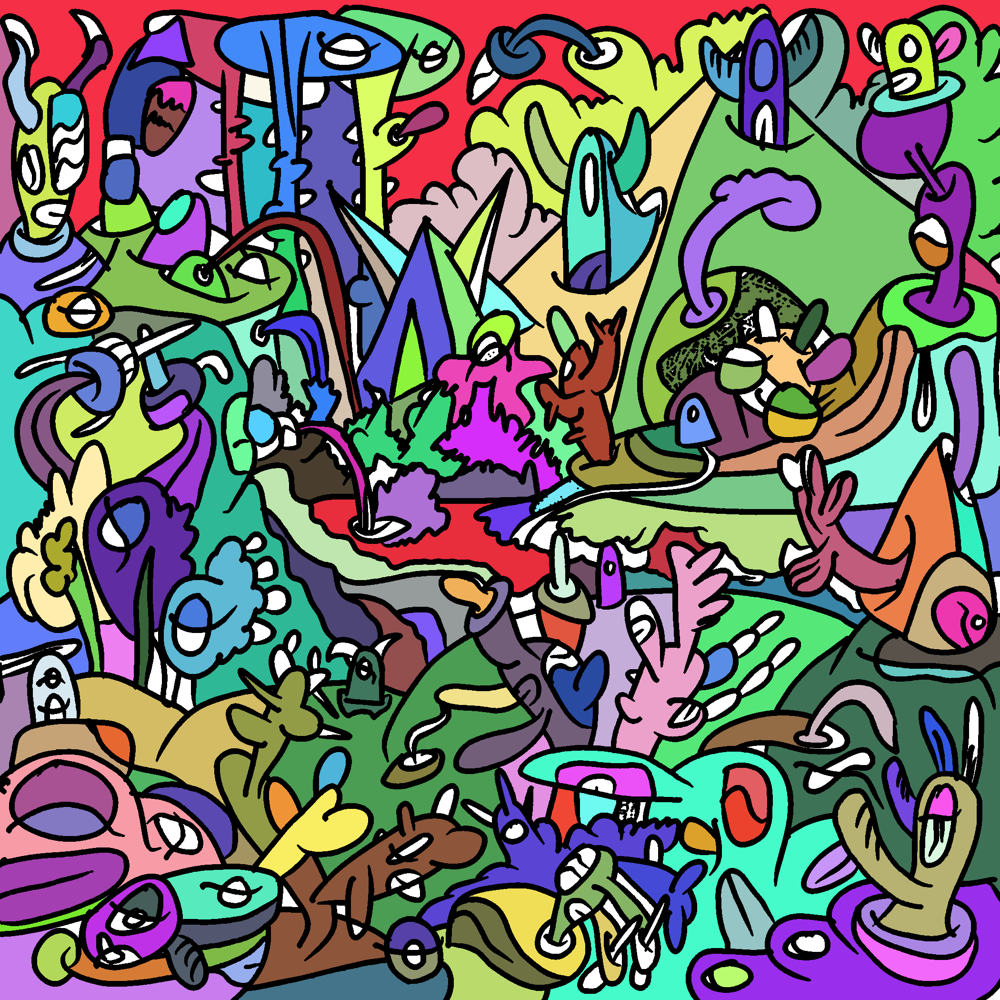
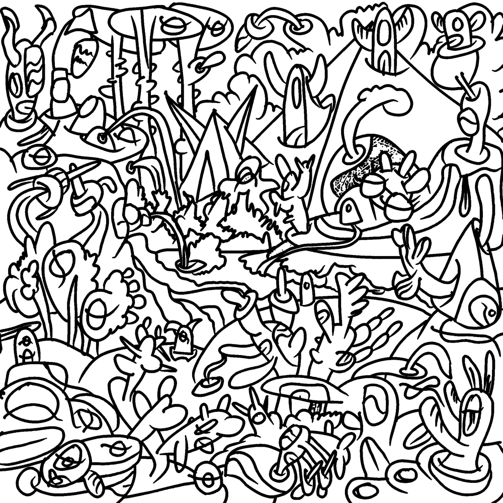

# Animation layer: plan for review

*Written 2026-10-24. Not implemented. Review, then PLAN.md gets the approved version.*

## 0. In one paragraph

Cut the painting along its own black lines into cells (closed shapes), group cells into objects (a creature is a
body cell plus an eye cell plus two horn cells), and give every object a way to move or change colour that uses
only what is already painted there. Then wire objects to Tonewheel in both directions: the 47 parameters each
own an object whose visual state tracks the parameter continuously (a preset change makes the whole painting
shift at once), the 88 piano notes each own a cell that lights and boils while the note sounds, and the same
objects stay touchable so a drag on one still sets its parameter. The ink lines stay on top, untouched except
for a hand-drawn line boil, so the piece keeps looking like the piece.

A first experiment (`docs/segmentation-experiment.py`) already finds the cells: 623 closed cells, 220 of them
larger than about 45 × 45 px, 79 larger than about 100 × 100 px. We need 135 distinct elements, so the counts
work with room to leave the sky, the background hills, the title and the signature alone.




## 1. Identifying visual objects

Three levels, each produced by a tool or an editor, all stored as data in `art/<slug>/`:

**Cells (automatic).** `tools/segment.py` (Python with Pillow, numpy, scipy; run with `uv run`, the only
non-stdlib Python in the repo, and only at authoring time, never in the browser):
1. Crop to the painted area inside the white border (found automatically: 187..2287 px both ways).
2. Ink mask: a pixel is ink when its luminance is below 90 and its saturation below 60. Dilate by 2 px to close
   anti-aliased gaps. This is the line drawing in the second picture above.
3. Connected components of everything that is not ink: one label per cell. Drop cells under 2000 px (they are
   line junctions and JPEG noise) and merge them into their largest neighbour so the label map has no holes.
4. Per cell: id, area, bounding box, centroid, mean colour, dominant hue, list of neighbouring cells (cells that
   share a stretch of ink), and the outline traced as a simplified polygon (marching squares + Douglas-Peucker,
   about 1 px tolerance) so it can also be an SVG path for hit-testing and the debug outlines.
5. Outputs: `cells.json` (the table), `labels.png` (a 16-bit label map, one value per pixel, the thing the
   renderer uses), `ink.png` (the ink mask), and `cells-preview.png`.

Known leaks: where a line has a gap, two shapes become one cell (the sky is one cell because the pencil
scribbles are not ink; the big pink shape bottom-left absorbed part of the creature on it). Fix: an
`overrides.json` with extra cut strokes (a polyline in image pixels that the tool paints as ink before
labelling) and explicit merges. A handful of cuts should be enough; the editor below draws them.

**Objects (semi-automatic, then by hand).** An object is a named group of cells with a role for each cell.
The tool proposes groups from the adjacency graph: a small cell fully enclosed by a larger one is a *part* of it
(an eye in a face, a stripe on a horn); cells that only touch each other and share a hue are candidates for
one object. I then do a pass by eye on crops of each proposed group (I can look at the image) and name them
("left-horned-creature", "golden-pyramid", "tunnel-mouth", "stream", "ring-in-sky", "stalk-tree-3"). The
result is `objects.json`: id, label, cells with roles (body, eye, mouth, horn, stripe, highlight), bbox,
centroid. Expect 60 to 90 objects. Matt reviews in the editor and regroups anything wrong.

**Elements to bind.** From the counts: 47 objects for parameters, chosen big and distinct (the pyramid, the
tunnel, the stream, the ring, the tower, the big creatures); 88 cells for notes, chosen small and flat-filled
(eyes, blobs, leaves, the crowd), none of them part of a parameter object so the two never fight. Everything
else is scenery that can still idle (section 3).

## 2. Rendering the animated painting

The painting is raster: gradients, soft shading, pencil scribbles. Vectorising it would lose exactly the things
that make it look hand-made, so we never redraw it. We animate its own pixels, per cell, with a label map.

**WebGL2 layer (recommended).** One full-screen quad, two textures: the painting and the 16-bit label map
(2475², about 12 MB in memory, downsampled to 1024² on phones). A third small texture holds per-cell state: for
each cell id, a few floats updated every frame from the main thread (value 0..1, flash 0..1, phase, effect
flags). The fragment shader looks up the cell under the pixel, reads its state, and applies the effect to the
painting's colour at that pixel. Every cell animates in one draw call at 60 fps; adding a cell costs nothing.
The ink is drawn last from the ink mask, so lines always sit on top.

**Fallback.** An SVG layer with one `<clipPath>` per bound cell (135 paths) over `<image>` copies with CSS
filters. Simpler, no shader, slower on the full-size painting; worth keeping as the no-WebGL path.

The existing SVG hit layer stays for input: object outlines from `objects.json` replace the hand-drawn rects
in `mapping.json`, and `?debug` draws them as now.

## 3. The motion vocabulary (what "change visual state" means)

Every effect is a function of a value v in 0..1 (continuous parameters) or an envelope (notes: attack on
note-on, decay after note-off), computed per cell in the shader from the painting's own pixels. Rules that keep
it in the style of the piece: no new shapes; colours only move within the painting's own candy palette;
motion is small and either glides (parameters) or steps at 8 to 12 fps like hand-drawn animation (notes,
boil); ink on top, always.

| effect | what it does | good for |
| --- | --- | --- |
| `glow` | lightness up, slight saturation up, within the cell | note cells (velocity → amount), bools |
| `hue` | rotate the cell's hue by up to ±60° (the piece is rainbow, so a shifted cell still belongs) | continuous params: drive, leakage, mic distance |
| `fill` | the cell fills from bottom to top with its brightened colour, like a drawbar pulled out | the 20 drawbars (0..8 → 0..1) |
| `pulse` | scale the cell's pixels about its centroid by ±3 %, breathing at a rate | expression, pedal sustain, Leslie speed (stop / slow / fast = still / slow breath / fast breath) |
| `wobble` | small sinusoidal displacement of the cell's pixels, like heat shimmer | vibrato / chorus mode and depth |
| `boil` | the ink inside the cell's dilated outline jitters by 1 to 2 px, re-rolled at 8 fps (the classic hand-drawn line boil) | any cell while its note is on; percussion on |
| `scribble` | procedural pencil scribble strokes in the cell's colour, in the manner of the scribble underlayer, drawn with density = v | wheel age, key click, crosstalk |
| `spin` | rotate the cell's pixels about its centroid (only for round things) | the ring in the sky for the Leslie rotor (speed from telemetry if the engine publishes rotor angle) |
| `blink` | swap the cell to its mean colour for a frame or two | eyes on tap / note cells of the crowd |

Composite objects combine them by role: a creature glows in the body, blinks in the eye, boils its horns.

**Idle.** Unbound scenery gets a very slow, very small `wobble` so the painting is never fully still; off while
nothing is playing for a minute.

**Transitions.** Parameter values are smoothed on the way into the state texture (about 150 ms, 400 ms for
preset loads), so a preset change reads as a wave moving through the painting rather than a cut. Notes use an
envelope: 10 ms attack, 300 ms release, longer for the pedal cells.

## 4. Binding objects to Tonewheel

`mapping.json` becomes v2 with two directions:

```jsonc
{
  "schema": "thingsynth.mapping/2",
  "objects": "art/<slug>/objects.json",
  "bindings": [
    { "object": "golden-pyramid", "param": "amp.drive", "range": [0, 1], "curve": "linear",
      "gesture": "drag-x",                     // input, as today
      "effects": [ { "cells": "body", "effect": "hue", "amount": 0.5 },
                   { "cells": "highlight", "effect": "glow" } ] },
    { "object": "tower-right", "param": "upper.db3", "range": [0, 8], "gesture": "drag-y",
      "effects": [ { "cells": "body", "effect": "fill" } ] },
    { "cell": 412, "note": 60, "effects": [ { "effect": "glow" }, { "effect": "boil" } ] },
    { "object": "ring-in-sky", "telemetry": "leslie.rotor", "effects": [ { "effect": "spin" } ] }
  ]
}
```

- **Parameters (47).** The binding's object is both the touch region (today's gestures) and the display. The
  display follows `host.onParam`, so whatever sets the parameter (a drag, a preset, MIDI CC) moves the object.
- **Notes (88).** `host.audio.midi` is extended with a note tap (the runtime copy already routes keyboard and
  MIDI through one sink; thingsynth listens there, no upstream change needed). Note cells are assigned by a
  rule with manual overrides: bigger cell = lower pitch, ties by position left to right; the 88 cells are
  spread across the whole canvas so a chord lights several places. Velocity scales the glow.
- **Presets.** Nothing extra: loading one changes 47 parameters, and 47 objects move together.
- **Telemetry.** The runtime exposes `host.onTelemetry` (engine-defined numbers). If the additive engine
  publishes the rotor angle or level, the ring can spin at the real Leslie speed; otherwise the rotor speed
  parameter drives `pulse` rates. To check upstream.
- **Meter.** `host.onMeter` gives output level and voice count; the stream's cells can brighten with level.

### 4.1 Shuffle: random reassignment

The bindings are data, so the pairing of parameters to objects and notes to cells can be regenerated at will.
`mapping.json` v2 separates three things: the **pool** of objects and cells with the effects each is allowed to
show (a round thing may `spin`, an eye may `blink`, a tall thing may `fill`), the **sources** (the 47 parameters,
the 88 notes, telemetry), and the **assignment**, which is either listed explicitly or produced by a seeded
shuffle:

- `?seed=<n>` (or a Shuffle button in the bottom bar) deals the parameters and notes onto the pools with a
  deterministic random permutation, so a seed is shareable and reproducible. No seed means Matt's curated
  assignment.
- The shuffle is type-aware: a drawbar (0..8) only lands on an object that can `fill`, a bool on one that can
  `glow` or `blink`, a choice on one with as many visible states as choices, and so on. Each object keeps the
  gesture that fits its shape (tall: drag-y, wide: drag-x, small: tap or hold).
- Bindings can be **locked** (`"locked": true`): the shuffle leaves them in place. So the pyramid can stay
  drive for ever while everything else re-deals.
- Reassigning on the fly animates: the old object fades its effect out over a second while the new one fades
  in, so a shuffle is itself a visible event in the painting.
- Notes shuffle separately from parameters (`?seed=12&notes=random`), since re-dealing 88 cells changes what a
  chord looks like without changing what a knob does.

## 5. Authoring workflow (for Matt)

1. `uv run tools/segment.py art/<slug>` after any change to overrides; outputs are committed.
2. `pnpm dev`, `?debug` gains a *cells* mode: hovering highlights the cell under the pointer with its id, area
   and object; clicking prints it; shift+click on two cells draws a cut stroke (saved to overrides) or merges
   them; `g` groups selected cells into a new object and asks for a name; the object list is a side panel.
3. *Bind* mode: pick an object, pick a parameter or a note from a list, pick effects; the entry is appended to
   `mapping.json` and takes effect on save (Vite hot reload). The pipeline is the same JSON as today.
4. I do the first full pass (segmentation fixes, object names, all 135 bindings with effects) as a proposal
   and Matt corrects it in the editor. Matt's instructions can stay in words ("the pyramid is drive, the
   tunnel mouth opens with the 16' drawbar"); the editor turns them into bindings in seconds.

## 6. Milestones

1. **Segment**: `tools/segment.py`, `cells.json`, `labels.png`, `ink.png`, overrides for the obvious leaks,
   the cells debug mode. Checked by eye against the painting.
2. **Render**: the WebGL label-map layer with `glow` and `hue`, `amp.drive` driving the pyramid end to end,
   SVG fallback. Checked in the browser with `?debug` and the meter.
3. **Vocabulary**: the rest of the effects, note cells, envelopes, transitions, idle.
4. **Objects and bindings**: grouping, names, the proposal for all 47 + 88, the bind editor; Matt's review.
5. **Polish**: line boil quality, scribble style tuned against the real scribbles, phone performance, a
   recorded demo.

## 7. Open questions for Matt

- **The original file.** Matt has an Adobe file somewhere. A layered PSD can be read with `psd-tools` and each
  layer exported at full resolution (ink, fills, scribbles separately); an Illustrator file is PDF-compatible and
  may give the ink as true vector paths. Either removes every segmentation leak and lets the boil and blink
  work on real lines rather than a mask pulled from a JPEG. The source file stays out of the repo; only the
  exported layers are committed.
- **How much motion.** The plan keeps everything small and local. Is a stronger reading wanted anywhere, for
  example the stream actually flowing, or the sky's scribbles drifting with the Leslie?
- **Note layout.** Bigger-cell-is-lower-note across the whole canvas, or a spatial keyboard (low notes left,
  high notes right, so a scale sweeps across the painting)? Both are one rule in the tool.
- **Parameters vs objects.** Should the eight macros get the eight largest, most central objects (pyramid,
  tunnel, stream, ring, tower, three big creatures), with the 39 others on smaller objects? That is my default.
- **The hidden 214.** Any of the Leslie physics or vibrato rate parameters wanted as bonus objects?
- **Touch and phones.** The WebGL layer at 1024² should run on a phone; hover effects will not exist there.
